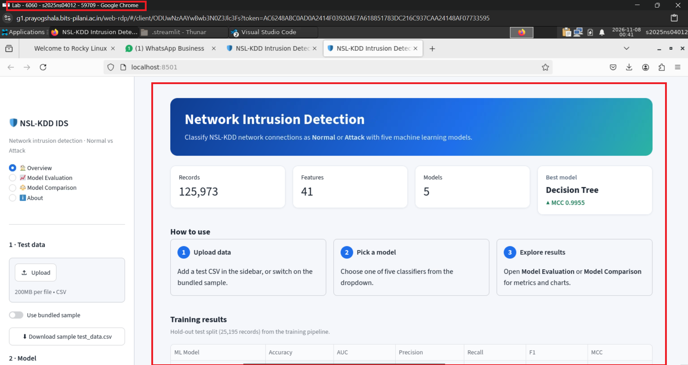
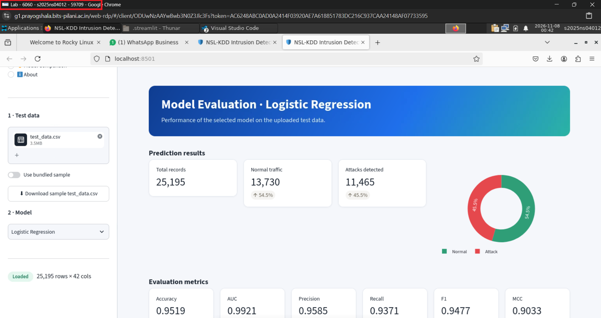
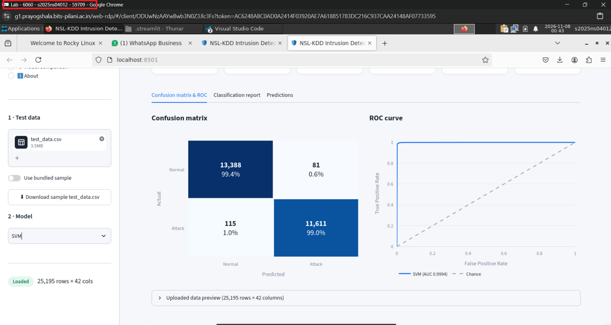
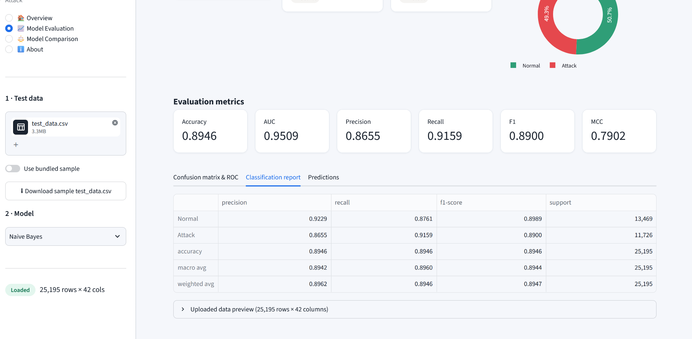
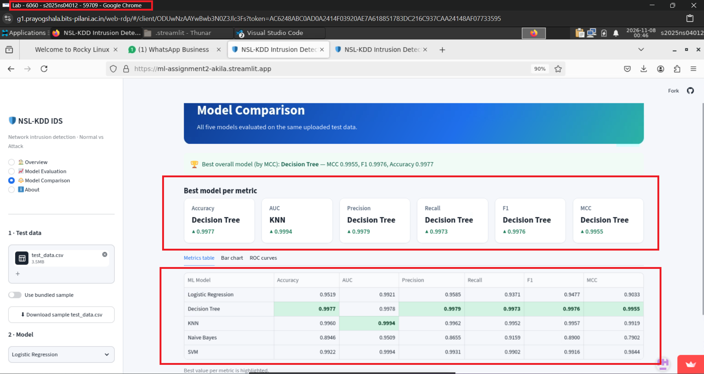
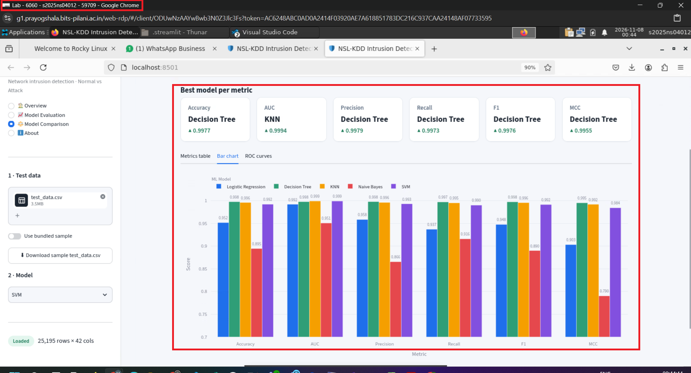
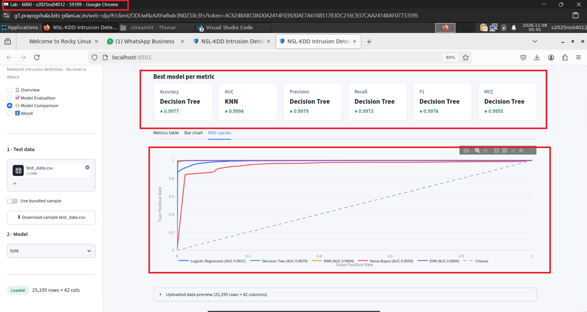
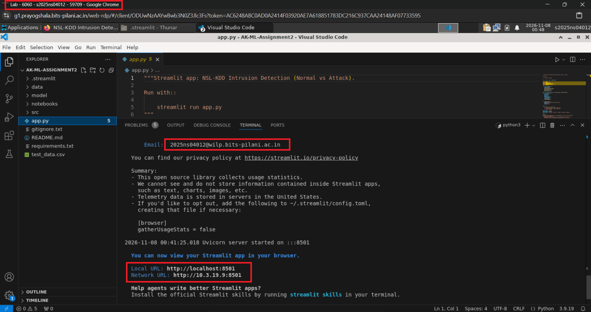

# ML-Assignment2 — Network Intrusion Detection (NSL-KDD)

## 1. Problem Statement

Build an **Intrusion Detection System (IDS)** that classifies network
connections from the NSL-KDD dataset as **Normal** or **Attack**
(binary classification). Five classifiers are trained and compared with
Accuracy, AUC, Precision, Recall, F1 and Matthews Correlation Coefficient
(MCC), and are served through an interactive Streamlit application.

## 2. Dataset Description

| Item | Details |
|------|---------|
| Source | NSL-KDD — <https://www.kaggle.com/datasets/hassan06/nslkdd> (`KDDTrain+.txt` is used) |
| Records | 125,973 (no missing values, no duplicates found) |
| Features | 41 (38 numeric + 3 categorical: `protocol_type`, `service`, `flag`) |
| Target | `label` converted to binary: `normal` -> 0 (Normal), any attack type -> 1 (Attack) |
| Class balance | ~53.5% Normal / ~46.5% Attack |
| Split | Stratified 80/20, `random_state=42` -> 100,778 train / 25,195 test |

**Preprocessing:** missing-value imputation (median / mode, learned on the train
split), duplicate removal, `LabelEncoder` for `protocol_type`, `service`, `flag`,
`StandardScaler` on all features, stratified train/test split with fixed seed.
The `difficulty` column is dropped.

## 3. GitHub Repository Link

<https://github.com/2025ns04012-Akila-B/ML-Assignment2.git>

**Live Streamlit App:** <https://ml-assignment2-akila.streamlit.app>


## 4. Models Used

Metrics computed on the 25,195-record hold-out test split (Attack = positive class):

| Model | Accuracy | AUC | Precision | Recall | F1 | MCC |
|-------|----------|-----|-----------|--------|----|-----|
| Logistic Regression | 0.9519 | 0.9921 | 0.9585 | 0.9371 | 0.9477 | 0.9033 |
| Decision Tree | 0.9977 | 0.9978 | 0.9979 | 0.9973 | 0.9976 | 0.9955 |
| KNN | 0.9960 | 0.9994 | 0.9962 | 0.9952 | 0.9957 | 0.9919 |
| Naive Bayes | 0.8946 | 0.9509 | 0.8655 | 0.9159 | 0.8900 | 0.7902 |
| SVM | 0.9922 | 0.9994 | 0.9931 | 0.9902 | 0.9916 | 0.9844 |

## 5. Model Performance Observations

- **Logistic Regression:** Strong linear baseline (95.2% accuracy, AUC 0.992),
  but the linear boundary cannot capture all attack patterns; it misses ~6% of
  attacks.
- **Decision Tree:** Best accuracy, F1 and MCC. Attack signatures in NSL-KDD are
  largely rule-like (flags, services, error rates), which a tree models very well.
  Being an unpruned tree, it should be validated on other data (e.g. `KDDTest+`)
  to rule out overfitting.
- **KNN:** Very strong (99.6% accuracy, AUC 0.9994) because similar connections
  cluster tightly after scaling; prediction is slower and the model file stores
  the full training set.
- **Naive Bayes:** Weakest model (89.5% accuracy, MCC 0.79). The independence
  assumption is violated by many highly correlated features and the Gaussian
  assumption does not fit skewed count/rate features. It is, however, the
  fastest to train.
- **SVM:** Excellent generalisation (99.2% accuracy, AUC 0.9994, tied-best) with
  a compact model; training is the slowest (~45 s) of the five.

## 6. Overall Winner

**Decision Tree** — highest Accuracy (0.9977), Precision, Recall, F1 (0.9976) and
MCC (0.9955). KNN and SVM are tied for the best AUC (0.9994) and are the closest
competitors.

## 7. How to Run

```bash
pip install -r requirements.txt
streamlit run app.py
```

Optional — reproduce training (downloads `KDDTrain+.txt` into `data/` automatically):

```bash
python -m src.train_models        # trains models, writes model/*.pkl and test_data.csv
python -m src.export_test_data    # only re-exports test_data.csv
```

The notebook `notebooks/training.ipynb` runs the same pipeline step by step.

In the app: upload `test_data.csv` (or tick "Use bundled sample"), pick a model
and browse **Model Evaluation** and **Model Comparison**. The uploaded CSV needs
the 41 feature columns and, to see metrics, a `label` column.

## 8. Streamlit Deployment Steps

1. Push this project (including `model/*.pkl`, `test_data.csv` and
   `requirements.txt`) to a public GitHub repository.
2. Go to <https://share.streamlit.io> and sign in with GitHub.
3. Click **Create app** -> **Deploy a public app from GitHub**.
4. Select the repository, branch (`main`) and set the main file path to `app.py`.
5. Click **Deploy**. Streamlit Cloud installs `requirements.txt` automatically.
6. Copy the generated app URL and add it to this README.

This project is deployed at <https://ml-assignment2-akila.streamlit.app>
(repository `2025ns04012-Akila-B/ML-Assignment2`, branch `main`, main file
`app.py`, Python 3.12).


> `scikit-learn` is pinned to the version used to create the `.pkl` files
> (1.8.0), because pickled models must be loaded with the same version.

## 9. Screenshots

**Overview**



**Model Evaluation - prediction results and metrics**



**Model Evaluation - confusion matrix and ROC curve**



**Model Evaluation - classification report**



**Model Comparison - metrics table (deployed app)**



**Model Comparison - bar chart**



**Model Comparison - ROC curves**



**Running the app from the terminal**




## Project Structure

```
app.py
requirements.txt
README.md
test_data.csv
model/            logistic_regression.pkl, decision_tree.pkl, knn.pkl,
                  naive_bayes.pkl, svm.pkl, preprocessor.pkl, training_metrics.csv
notebooks/        training.ipynb
src/              preprocessing.py, train_models.py, evaluate.py, utils.py,
                  export_test_data.py
```